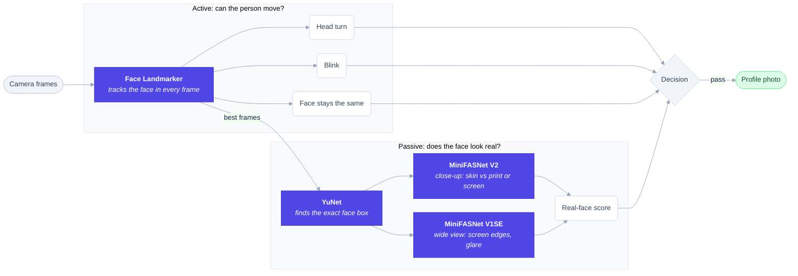

# Liveness

A small face liveness check that runs on the CPU. The server gives a random
challenge (turn left, turn right, blink), checks it on frames recorded in the
browser, and runs a passive anti-spoof model on the same frames. After a pass,
the user can pick a profile photo from the recording.

Every check runs on the server. The browser only records and shows hints.

## How it works



```
browser                                   server
  │ POST /api/session ──────────────────▶ create session
  │ ◀──────── {id, actions: ["turn_left", "blink"], expires_in: 60}
  │ show prompts, record 15 fps
  │ POST /api/session/{id}/frames ──────▶ all frames: Face Landmarker
  │                                         → head angle, blink, continuity
  │                                       5 frames:   YuNet + MiniFASNet x2
  │                                         → passive score, quality
  │ ◀──────── {decision, reasons, scores, details, photos}
  │ POST /api/session/{id}/photo ───────▶ chosen photo (JPEG)
```

## Models

Downloaded by `setup` (pinned URLs, SHA-256 checked). Not stored in this repo.

| Model | Job | Size | License |
|---|---|---|---|
| [MediaPipe Face Landmarker](https://ai.google.dev/edge/mediapipe/solutions/vision/face_landmarker) | head angle, blink, face presence | 3.8 MB | Apache 2.0 |
| [YuNet](https://github.com/opencv/opencv_zoo/tree/main/models/face_detection_yunet) | face box for the passive crop | 0.2 MB | MIT |
| [MiniFASNet V2](https://github.com/minivision-ai/Silent-Face-Anti-Spoofing) | passive check, close crop (2.7x) | 1.7 MB | Apache 2.0 |
| [MiniFASNet V1SE](https://github.com/minivision-ai/Silent-Face-Anti-Spoofing) | passive check, wide crop (4.0x), converted to ONNX | 1.7 MB | Apache 2.0 |

## Requirements

- macOS or Linux, Python 3.13, [uv](https://docs.astral.sh/uv/), `curl`, `shasum`
- 2 CPU cores, 512 MB RAM, 500 MB disk. No GPU.
- About 1 s of CPU per check on an Apple M2 Pro.

## Usage

```sh
./liveness.sh setup     # venv, models, checksums, V1SE conversion
./liveness.sh check     # load every model
./liveness.sh test      # run the tests
./liveness.sh start     # serve in the background on 127.0.0.1:8090
./liveness.sh status
./liveness.sh stop
```

Other commands: `serve` (foreground), `trace DIR` (per-frame values for a
folder of JPEGs), `eval DIR` (see below), `convert`, `clean`.

To listen on another address, set `HOST` and `PORT` in the environment or in a
`.env` file next to `liveness.sh`:

```sh
HOST=0.0.0.0
PORT=8090
```

Logs go to `~/Library/Logs/liveness-v2.log`. Only measurements are logged; no
images are written to disk unless `SAVE_DIR` is set (see below).

The camera needs HTTPS (or `localhost`), so put a reverse proxy with TLS in
front of it when serving to other devices.

## Measuring accuracy

Record labeled sessions, then re-run the checks on them. Saved frames are face
data: keep `data/` private (it is in `.gitignore`) and delete it when done.

```sh
./liveness.sh stop
SAVE_DIR=data ./liveness.sh start     # or put SAVE_DIR=data in .env
./liveness.sh eval data
```

With `SAVE_DIR` set, the normal page (`/`) shows a link to the test page
(`/test`). The test page asks what is in front of the camera (real face,
printed photo, photo or video on a screen, other) and asks for consent. A
session is saved to `data/<label>/` only when it was started from `/test` and
the box is ticked; the normal page never saves. The label does not change the
decision. Without `SAVE_DIR` there is no test page and nothing is saved.

`eval` prints each session's decision and reasons, then per label:

- `real`: **BPCER**, real people not passed (aim below 5-10%)
- every other label: **APCER**, attacks passed (aim for 0)
- passive score min/median/max, to place the 0.3 and 0.7 thresholds
- time per check (p50, p95)

After changing a rule, run `eval` again on the same data; no new recording is
needed. Record at least 30 sessions per label: if none of 30 attacks pass, the
true pass rate is very likely under 10% (under 3% for 100).

## Rules

| Check | Rule |
|---|---|
| Frames | 15-250 frames, times increasing, 5-20 fps, sent within 60 s |
| Face | one face, at least 20% of the frame |
| Continuity | face lost at most 0.6 s; small moves and size changes between frames |
| Turn | head turns 20° from the start toward the asked side, then back |
| Blink | blink score rises 0.20 above the open-eye level and falls within 0.6 s, head still |
| Order | actions in the given order, all within 15 s |
| Quality | brightness and sharpness in range on the sampled frames |
| Passive | average real score of MiniFASNet V2 and V1SE on 5 frontal frames |

| Result | When |
|---|---|
| `PASS` | all rules met and passive score >= 0.7 |
| `FAIL` | any rule broken, or passive score < 0.3 |
| `UNCERTAIN` | everything else (`PASSIVE_BORDERLINE`) |

Reason codes: `CHALLENGE_MISSING`, `CHALLENGE_ORDER`, `TOO_SLOW`, `NO_FACE`,
`MULTIPLE_FACES`, `FACE_CHANGED`, `LOW_QUALITY`, `PASSIVE_LOW`,
`PASSIVE_BORDERLINE`, `BAD_FRAMES`, `EXPIRED`.

## API

| Method | Path | Body | Returns |
|---|---|---|---|
| POST | `/api/session` | - | `{id, actions, expires_in}` |
| POST | `/api/session/{id}/frames` | multipart `frames` (JPEG, many) + `times` (JSON list, ms) | `{decision, reasons, actions, scores, details, photos}` |
| POST | `/api/session/{id}/photo` | `{"choice": n}` | JPEG |
| GET | `/health` | - | `{status}` |
| GET | `/` | - | web page |

Limits: 300 KB per frame, 20 MB per request, 10 sessions per client IP per
minute. Sessions are single use and kept in memory. Photos are kept for 5
minutes after a pass, then dropped.

## What it does not stop

- 3D masks.
- Deepfakes or virtual cameras that inject frames into the browser.
- A smooth face swap during the session.

MiniFASNet alone misses many attacks, so the challenge is the main check and
the passive score is a second signal. Thresholds are not tuned on a labeled
dataset yet.

## Test clips

`tests/clips/` holds 10 fps frames from Pexels stock videos
[8627673](https://www.pexels.com/video/8627673/),
[6620642](https://www.pexels.com/video/6620642/) and
[6968225](https://www.pexels.com/video/6968225/), used under the
[Pexels license](https://www.pexels.com/license/).
